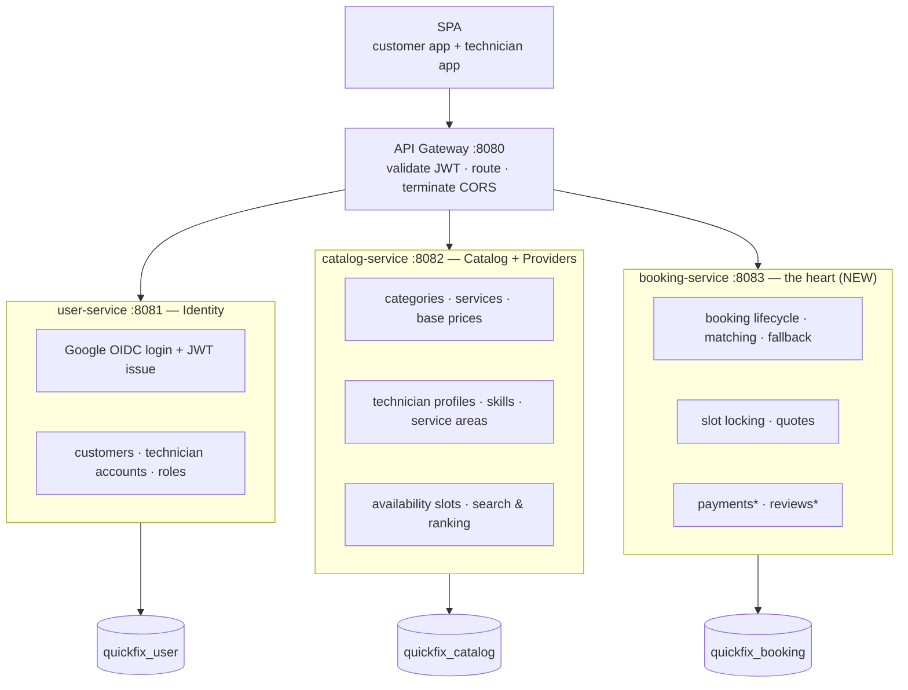
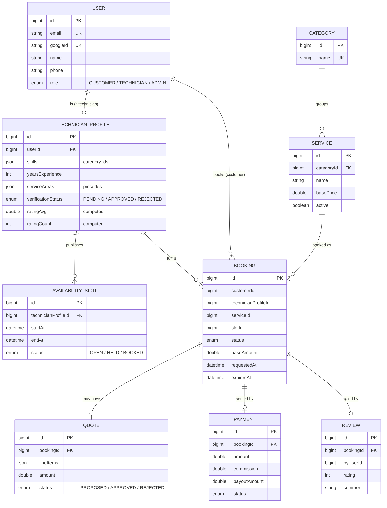
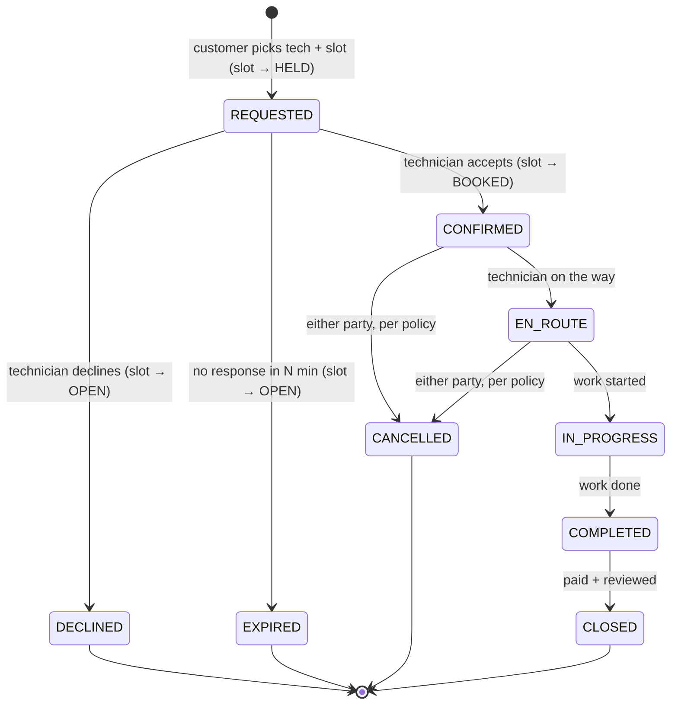
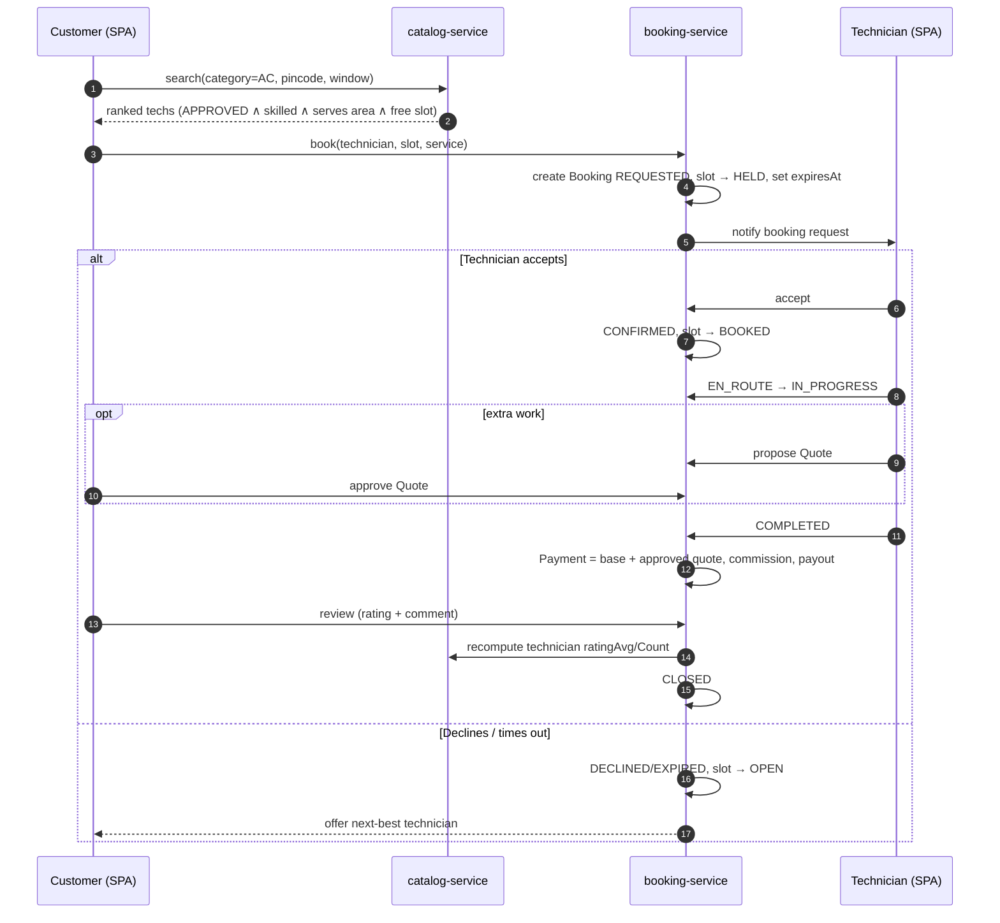

# QuickFix — Target Architecture

QuickFix is a two-sided **home-services marketplace**: customers find and book
skilled technicians (AC, washing machine, refrigerator, etc.), and technicians
manage their profile, availability, and jobs.

This document describes the **target architecture** — where the system is
headed. It is a design blueprint, not the current state of the code. See
[Current state](#current-state--migration) at the end for the gap.

---

## Product model (decided)

Three product decisions anchor the whole design:

| Decision | Choice | Why |
| --- | --- | --- |
| **Booking model** | **Pick + accept / fallback** | Customer browses ranked, available technicians and picks one; the technician accepts or declines; on decline/timeout the customer is offered the next best. Keeps "choose your technician" trust while staying availability-accurate. |
| **Availability** | **Slot / calendar** | Technicians publish working hours and bookable slots with capacity. Home visits are scheduled, not instant, and slots prevent double-booking. |
| **Pricing** | **Catalog base price + in-job quote** | A base/visit fee is shown upfront; after inspection the technician can propose a quote (parts/labor) that the customer approves in-app. Transparent and realistic. |

---

## Service map

The SPA serves both the customer and technician experiences and talks to a
single gateway origin. Behind it sit three services, each owning one database.



`*` Payments and Reviews begin **inside** booking-service and are split out only
if they grow. Three services is the right size for this system — resist adding
more until a clear seam demands it.

### Responsibilities

- **user-service (Identity).** Google OIDC login, JWT issuance, and user
  accounts. Everyone — customer, technician, admin — is a `User` with a role.
- **catalog-service (Catalog + Providers).** The service catalog (categories,
  services, base prices), technician *profiles* (skills, service area,
  verification, computed rating), availability slots, and the **search/ranking**
  that powers discovery.
- **booking-service (the heart).** The booking state machine, matching and
  fallback, slot locking, in-job quotes, and initially payments and reviews.

---

## Domain model



Key modelling rules:

- **Account vs. profile are separate.** A technician is a `User` (in
  user-service) *plus* a `TechnicianProfile` (in catalog-service). This resolves
  today's ambiguity where "technician" exists both as a role and as a standalone
  entity.
- **Rating is computed**, not an editable field — it is derived from `REVIEW`
  rows and cached on the profile as `ratingAvg` / `ratingCount`.
- **Relationships across services are logical ids**, not database foreign keys.
  No cross-service joins.

---

## The technician lifecycle

```
Sign up as TECHNICIAN
  └─ build profile: skills, years of experience, service area (pincodes),
     pricing, photo, KYC documents
  └─ verificationStatus: PENDING ──(admin reviews)──► APPROVED  (now listable)
                                                   └► REJECTED

Set availability: working hours + capacity  ──►  bookable OPEN slots
  (block days off, flip "accepting bookings")

Receive a booking request  ──►  ACCEPT (within N minutes)  or  DECLINE
  accept  → job confirmed, slot locked
  decline → customer offered the next-best technician

Run the job:  CONFIRMED → EN_ROUTE → IN_PROGRESS → COMPLETED
  (optional) propose a Quote mid-job → customer approves in-app

Get paid: platform takes commission → technician payout
Get rated: review feeds back into search ranking
```

Only `APPROVED` technicians appear in search.

---

## Booking lifecycle (state machine)



The **slot lock cycle is the critical concurrency rule**: a slot moves
`OPEN → HELD` the moment a booking is requested, `HELD → BOOKED` on accept, and
back to `OPEN` on decline, expiry, or cancellation. This is what lets
pick-and-accept and calendar availability coexist without double-booking.

---

## End-to-end flow



---

## Cross-cutting concerns

- **API Gateway** (Spring Cloud Gateway) terminates CORS once, validates the
  JWT once, routes by path prefix, and forwards identity (`X-User-Id` /
  `X-Roles`, or the JWT) to downstream services.
- **AuthZ in each service.** Services trust the forwarded identity and enforce
  *authorization* with `@PreAuthorize` (e.g. only `ADMIN` approves technicians;
  only the owning technician transitions their booking).
- **Validation.** Controllers accept **DTOs with `@Valid`**, never bind request
  bodies straight to entities.
- **Config & secrets.** No secrets in source or git history; signing keys and
  DB credentials come from environment variables or a secret store. Each service
  manages its schema with **Flyway/Liquibase migrations** instead of
  `ddl-auto=update`.
- **Notifications.** Booking events (requested, accepted, completed) drive
  notifications — start with email/DB events, add push later.

---

## Build roadmap

Each step is independently shippable.

1. **Identity & profiles** — technician as a `User` + `TechnicianProfile`
   (skills, service area, verification); admin approval flow.
2. **Availability slots** + **search / ranking** in catalog-service.
3. **booking-service: the state machine** + slot hold / accept / fallback. *(core)*
4. **In-job quote** proposal and approval.
5. **Payments** + commission / payout.
6. **Reviews → computed rating** (closes the loop back to search).
7. **Hardening** — gateway, auth on all services, DTO validation, migrations,
   secret externalization.

---

## Current state & migration

Today's code is an early slice, not this target:

- **user-service** has solid Google OIDC login, a stateless JWT filter, and
  per-user data scoping — the Identity foundation is real.
- **catalog-service** has `Category` / `Service` and a flat `Technician` entity,
  but **no authentication**, no DTO validation, and is **not yet called by the
  SPA**.
- There is **no booking-service** yet — the heart of the product is unbuilt.
- "Technician" is modelled twice (a `Role` value and a catalog entity) with
  nothing linking them; the target splits this into account + profile.
- Dev-only concerns remain: a DB password lives in git history, and both
  services run `ddl-auto=update`.

Getting from here to the target follows the roadmap above, starting with the
technician account/profile split in step 1.
